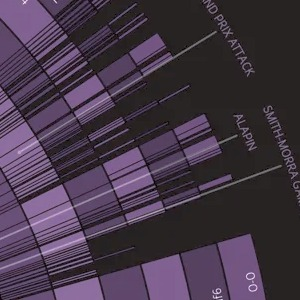
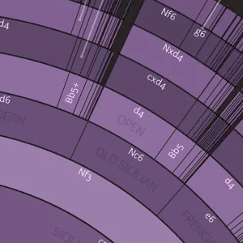
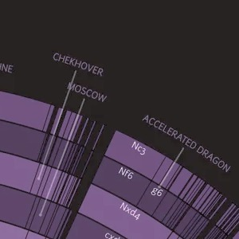
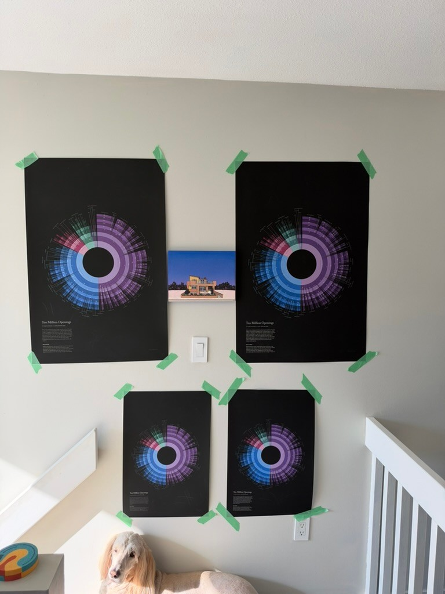
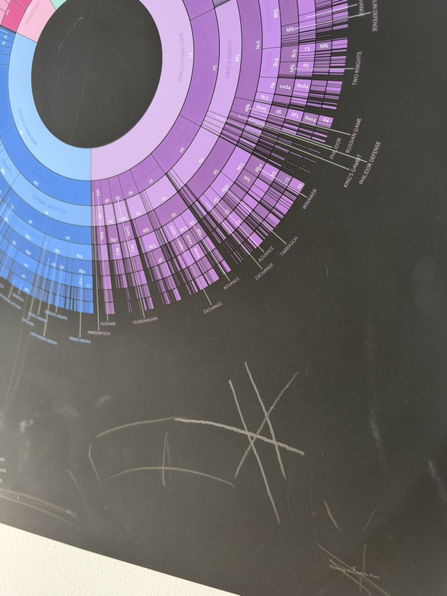
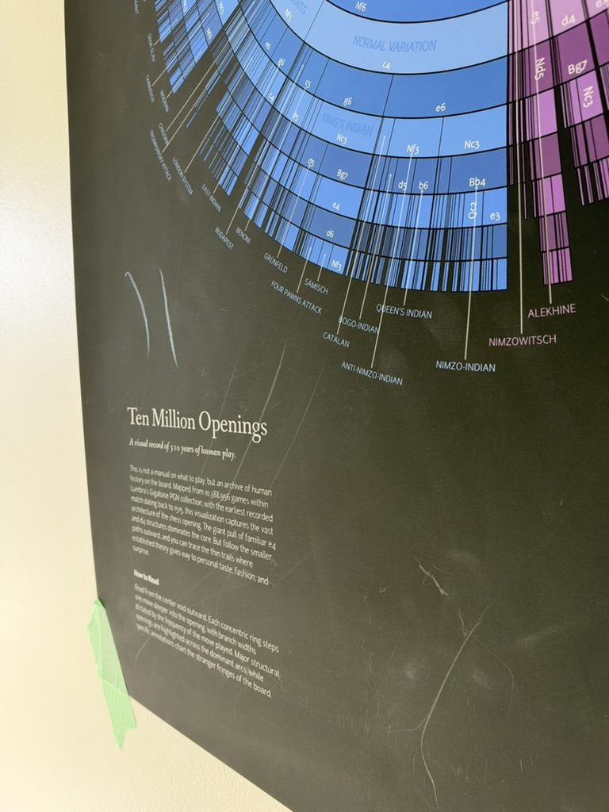
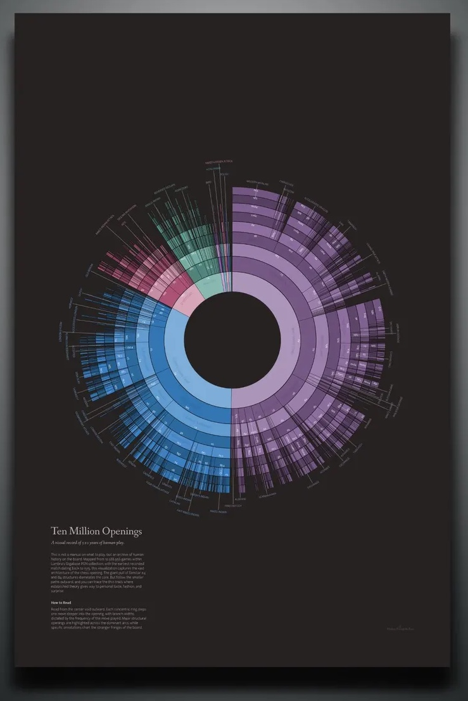

+++
responsive = true
title = "Making Of: Ten Million Chess Openings"
slug = "making-of-ten-million-chess-openings"
tags = ["chess", "data visualization", "long form", "making of", "print"]
shortSummary = "How the 2 million game openings sunburst became a print."
related = ["2016-02-27-visual-look-chess/index.md", "2018-12-29-chess-part2.md"]
image = "img/making-of-ten-million-chess-openings.png"
publishDate = "2026-10-25"
+++

Whenever I share something I make, I get a lot of emails and comments, mostly asking: "how did you make this?" The honest answer is usually _"slowly, and with a lot of fiddling"_. This blog is [open-source](https://github.com/ebemunk/blog), the only common tool I use is [d3](https://d3js.org/), and mountains of custom code. But no, I can't help you with tech support on this repo. Most are disheartened when they hear this; they want to hear there's some magic software that can just do it (and nowadays there just might be, with the proliferation of AI tools, that's another post).

So this is a "making of" post. It's about a poster I just finished, [Ten Million Chess Openings](https://madfilaments.etsy.com/listing/4531928752/chess-openings-data-art-ten-million), and by extension it's about the chess openings visualization it grew out of. I've wanted to make a print version of my dataviz work for a long time. I've had a few printed for myself over the years, but this is the first one I'm actually putting up for sale (the first of hopefully many). Instead of just rehashing an old viz, I wanted to bring you along for the ride as I took something built for a browser and turned it into ink on paper.

This isn't a tutorial or a step-by-step. It's more of a high-level tour through the things I tried, the knobs I turned, and the decisions I landed on. If I'm being honest, **I'm mostly winging it the whole time**, and I think that's part of the fun.

## Where it started

Back in 2016 I wrote [A Visual Look at 2 Million Chess Games](), digging through ~2M games from the MillionBase database. Out of everything in that post, the openings sunburst was the thing people kept coming back to. It got shared around a lot, and people spent a surprising amount of time just poking at it.

<video class="openings-recording" src="original-2016.mp4" poster="original-2016.jpg" autoplay loop muted playsinline controls width="692" height="720" style="display:block;max-width:100%;height:auto;margin:1rem auto"></video>

For me, it was an amazing way to explore chess openings. You hover over a slice and the board plays out the line, and you start to *feel* the shape of opening theory: how 1.e4 takes up half the world, how the Sicilian fans out into a hundred little branches, how some lines that sound popular are actually tiny slivers. It's very tactile.

The data side of this has always been [pgnstats](https://github.com/ebemunk/pgnstats), a PGN parser I wrote in Go for the original post. You point it at a PGN file and it chews through every game, building up the openings tree (and a bunch of other stats, like the heatmaps from the 2016 post) as it goes. It's made specifically for enormous files like MillionBase or Lumbra's Gigabase. That's a big part of why I could keep coming back to this: getting a fresh tree out of a new database is one command, and then all the fun happens on the drawing side.

The first public version actually came a little before the post, as part of [chess-dataviz](https://github.com/ebemunk/chess-dataviz), a D3 library I put together for these charts. It started life as a straight copy/paste of a d3 sunburst example, and over a couple of months it slowly turned into something chess-shaped.

The 2016 post used that same library, with a chessboard sitting in the middle of the circle that would play out whatever line you were hovering. Hover over an arc and you'd also get the opening name.

A quick note on the figures in this post: they're all static illustrations. No pieces on the board, no hovering, no tooltips. Some have a slider or a toggle so you can turn a knob yourself, but what I'm really trying to show here is how this turned into a print.

And then I just... kept coming back to it. I rewrote it in 2021, used a version of it for the [2022 Candidates]() recap, and eventually ended up building a custom app just to help me with the layout and all the knob turning while iterating on it. Every time I touched it I'd change something small, and over the years those small things added up.

## Knobs

This is the part I think is the most interesting, and also the part nobody sees. A sunburst looks like one decision, but it's really a pile of little ones, and every one of them changes the picture. The figures below are all drawn from the original 2 million game tree, with one thing changed at a time so you can see what each knob does.

### How deep to go

The first question is how many half-moves to show. Go too shallow and it's basically a pie chart: e4, d4, done. Go too deep and the outer rings turn into dust that you can't read or even see.

The 2016 version showed 10 plies. At some point in 2018 I refactored the parser and, without really noticing, it started producing 9. The poster also has 9 rings. I'd love to tell you that was a carefully considered artistic choice, but I honestly don't remember! It does look good though. Nine rings is just enough to walk you right up to the doorstep of the real named openings (the last ring of the Najdorf is 5.Nc3, one move short of 5...a6) without the outer ring falling apart.

### What to throw away

With millions of games, there's a very long tail of lines that were played once or twice. Some of those are real gems, and some are... questionable. Do you keep them?

In 2016 I cut anything played in less than 0.1% of games while parsing, so the smallest slice on that chart is still 2,199 games. That keeps things tidy, but it also hides the texture at the edges, which turns out to be one of the prettiest parts.

For the poster I kept it lighter, but not completely. I don't actually remember the exact threshold I used, but it feels right: on paper you can see far finer detail than on a screen.

### Squeezing the rings

Most of the data lives near the center. Every single game passes through the first ring, and the further out you go, the more the games spread out into thinner and thinner lines. So that's where the visual weight should be too. If every ring had the same thickness, the outer rings would end up with way more area (a ring's area grows with its distance from the center), and all that ink would go to the sparse fringe instead of the main lines. So the radius uses a square root scale, which gives every ring the same *area* instead of the same thickness. The inner rings get thicker, the outer ones thinner, and the center gets the weight it deserves.

A side effect I like a lot: the hole in the middle isn't a design decision, it's the "starting position" ring, the root that every game passes through, which just doesn't get drawn. With 9 rings, it ends up being about a third of the radius. For the 2016 post I put a chessboard in it, and for the poster I left it empty. More on that below.

### Gaps and lines between slices

How you separate slices sounds like a nitpick, but it changes the whole feel. The original library drew thin white lines, the easiest and simplest way to achieve the separation. The 2021 rewrite added small gaps between slices instead. Later on I switched to a very thin dark line.

In all cases, the issue is that you want the colored "ink" to correlate to the actual distribution of the data. This isn't a big deal for `e4` which takes up a big portion of the space, but if you're adding 1-2 pixel borders around tiny slivers, it actually takes away from the accuracy of the data for the farther moves. This is why sub-pixel lines are useful in the poster - it can delineate the different moves without affecting the actual size and scale of the inked area.

### Color

The very first version used a stock color palette. Later I switched to Tableau colors, which are nicer but still feel like "a chart". The color carries the first move: everything that starts with 1.e4 is one family, 1.d4 is another, and so on, with each ring getting slightly lighter or darker so you can still see the steps.

Picking the colors was only half of it. How the color changes from ring to ring was a pretty conscious decision, and it took a lot of iterating to get there. The first version was one flat color per first move, which makes each family read as a blob. Then I made the rings alternate darker and lighter, which has a nice side effect: every other ring is a White move, and the ones in between are Black's, so you can kind of see the back and forth of the game. Finally, everything gets a little darker as you go outward, so the eye is pulled towards the center, where most of the games are.

### Move names vs opening names

On the interactive version, the arcs show the moves (e4, c5, Nf3...) and the opening names live in a tooltip. That's great when you have a mouse. On paper, there's no hover, so the names have to be on the sheet somewhere, and that was a whole thing (see below).

### Board vs. no board

The board in the middle was one of my favorite parts of the original. You hover, it plays the line. But a board on a poster is just a static picture of a board, and it fights with everything around it for attention.

## From browser to paper

Here's where it gets interesting. I'd made some version of this chart a dozen times by now, but a screen and a sheet of paper are very different beasts. On a screen you can hover, zoom, and read a tooltip. On a wall it has to explain itself from across the room, and from two inches away. Almost every interactive feature had to be replaced with something else, so here are the decisions I landed on:

**Data.** First I needed more games. Back in 2016, MillionBase was the biggest free database around, so naturally I tried that first, but the link was down. Then I remembered that the owner of Caissabase had actually reached out to me at some point... about four years earlier. Oops. In the end I went with Lumbra's Gigabase, which I found through the [En Croissant database list](https://encroissant.org/docs/assets/databases). That's 10,388,956 games, almost five times what I had in 2016, so a big improvement. The earliest game in there is from 1515, which is where the subtitle comes from: "A visual record of 510 years of human play." I didn't do any fancy filtering either, it all went through pgnstats with the default settings.

  <svg class="openings-compare-data" viewBox="0 0 440 230" role="img" aria-label="Two circles sized by number of games: 2,197,113 in 2016, 10,388,956 for the poster">
    <circle cx="110" cy="112" r="44.1" fill="none" stroke="#9eabb3" />
    <circle cx="310" cy="112" r="96" fill="none" stroke="#ab95b8" />
    <text x="110" y="208" text-anchor="middle" class="big">2,197,113</text>
    <text x="110" y="226" text-anchor="middle">games · MillionBase · 2016</text>
    <text x="310" y="208" text-anchor="middle" class="big">10,388,956</text>
    <text x="310" y="226" text-anchor="middle">games · Lumbra's Gigabase · poster</text>
  </svg>
  
Circles sized by game count: about 4.7 times as many games.

**An empty center.** In the end I left the hole empty. It gives your eye somewhere to rest, and honestly the circle reads better as one object without a board in the middle. Every game starts there anyway.

**Background and color.** A warm near-black instead of a pure black, and a custom palette instead of a stock one. 1.e4 is violet, 1.d4 is sky blue, 1.Nf3 is pink, 1.c4 is mint. I wanted it to look good on a wall first, and like a chart second. Fun to see that e4 takes up about half the circle in this dataset, d4 about a third, and the rest share what's left.

  

    <figure class="openings-panel openings-swatches" style="background:#282c34">
      <figcaption class="openings-panel-label">Web (the original post)</figcaption>
      

      
<b>1.e4</b>

      
<b>1.d4</b>

      
<b>1.Nf3</b>

      
<b>1.c4</b>

      

      <figcaption class="openings-panel-note">d3's stock category10, on the blog's background.</figcaption>
    </figure>
    <figure class="openings-panel openings-swatches" style="background:#282323">
      <figcaption class="openings-panel-label">Poster</figcaption>
      

      
<b>1.e4</b>

      
<b>1.d4</b>

      
<b>1.Nf3</b>

      
<b>1.c4</b>

      

      <figcaption class="openings-panel-note">Custom palette, on the poster's warm near-black.</figcaption>
    </figure>
  

  
Each chip is a first move: the first ring's color on top, the second ring's below.

**Lines.** Always-on hairlines between slices. With no mouse, the slices need to separate themselves.

**Move names along the rings.** On screen, the move labels stay upright so they're easy to read. On the poster they follow the curve of each ring, which looks a lot more natural when you're standing in front of it.

**Opening names.** This was the most work by far. The bigger openings get their names written inside the arcs. For the smaller ones out at the edges, there are about fifty little callouts with leader lines pointing to their slice. My little layout app handled the rendering and let me toggle each label on and off and drag it around, but the actual placement was all by hand. Lots of nudging something two pixels to the left, staring at it, and nudging it back.

  

    <figure class="openings-panel openings-closeup">
      
      <figcaption class="openings-panel-note">Hairlines between slices, out at the fringe.</figcaption>
    </figure>
    <figure class="openings-panel openings-closeup">
      
      <figcaption class="openings-panel-note">Moves follow the rings; opening names sit underneath.</figcaption>
    </figure>
    <figure class="openings-panel openings-closeup">
      
      <figcaption class="openings-panel-note">Callouts, placed by hand.</figcaption>
    </figure>
  

**Type.** Fanwood and Junction, both from [The League of Moveable Type](https://www.theleagueofmoveabletype.com).

  

    <figure class="openings-panel openings-type openings-type-web">
      <figcaption class="openings-panel-label">Web (the original post)</figcaption>
      
A Visual Look at 2 Million Chess Games

      
e4 c5 Nf3 d6 d4 cxd4

      <figcaption class="openings-panel-note">The blog's heading font, and plain sans-serif for the move labels.</figcaption>
    </figure>
    <figure class="openings-panel openings-type openings-type-poster">
      <figcaption class="openings-panel-label">Poster</figcaption>
      
Ten Million Openings

      
A visual record of 510 years of human play.

      
SICILIAN DEFENSE · e4 c5 Nf3 d6

      <figcaption class="openings-panel-note">Fanwood for the title, Junction for the labels.</figcaption>
    </figure>
  

**Getting it printed.** This part was way less glamorous than I expected. I print through Prodigi, and my first few attempts at fancy press-ready exports (PDF, TIFF, a giant 4x render) all got rejected. What worked in the end was one 24×36" PNG master, resampled carefully. Then I ordered test prints and held my breath.

Four of them: two big, two small, each size on two different papers. Up on the wall with painter's tape, so I could see them in real life, from across the room and up close. My dog supervised the whole process.

  <figure class="openings-panel openings-closeup openings-photo">
    
    <figcaption class="openings-panel-note">The test prints: two sizes, two papers. Supervisor bottom left.</figcaption>
  </figure>

**Picking the paper.** The two contenders were Prodigi's "Smooth Art Paper" (240gsm) and their "Enhanced Matte Art Paper" (200gsm). Most of this poster is one big field of near-black ink, and that shows every mark, so I did the scientific thing and scratched them with my fingernail (no, it wasn't my dog's fingernail, you cannot prove anything).

  

    <figure class="openings-panel openings-closeup">
      
      <figcaption class="openings-panel-note">The fingernail test.</figcaption>
    </figure>
    <figure class="openings-panel openings-closeup">
      
      <figcaption class="openings-panel-note">Dark ink shows everything.</figcaption>
    </figure>
  

The Enhanced Matter Art paper came out ahead on both print quality and durability, so that's what the poster is printed on, even though it costs a bit more.

## Ten Million Openings

And here it is!

It's a little surreal to see something that started as a hover effect in a 2016 blog post hanging on a wall. Every slice is real games, every thin line out at the edge is someone, somewhere, trying something a bit different.

If you'd like one for yourself, or you know a chess player who'd love it, it's available on [Etsy](https://madfilaments.etsy.com/listing/4531928752/chess-openings-data-art-ten-million). Buying one genuinely helps me keep making these (and keep coming back to this sunburst for another ten years). If not, I hope you enjoyed the peek behind the curtain anyway. Let me know what you think, and if you have questions about any of the knobs, ask away!

<link rel="stylesheet" href="build/index.css">

